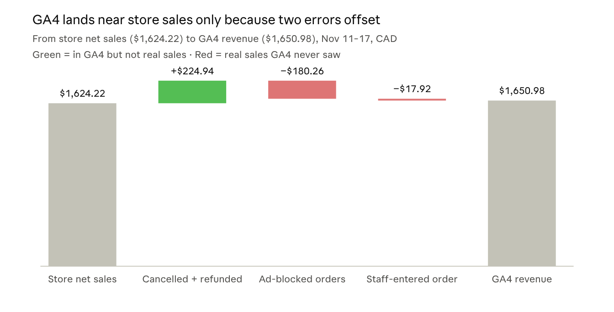

# Reconciliation results (Phase 7)

**Result: every one of the 39 orders was explained, and the SQL's label matched the answer key for all 39.** GA4 recorded 34 purchases worth $1,718.18. The store recorded 39 orders worth $1,963.34.

## The headline: a small gap hides two large errors

Against store **net** sales (cancelled and refunded orders removed), GA4 is off by only $20.22 (−1.2%). That looks like good tracking, but it is two errors cancelling out:

- GA4 **over-counts $224.94**: cancelled and refunded orders keep their revenue, because GA4 never hears about the change.
- GA4 **under-counts $245.16**: ad-blocked, pre-launch and staff-entered orders never reach it.

A dashboard that only compares totals would call this a match. Order-level reconciliation shows that both numbers are wrong, in opposite directions.

*The bridge above leaves out the four setup and QA orders (#60–#63), which a real store wouldn't have: store net $1,624.22 + $224.94 cancelled/refunded − $180.26 ad-blocked − $17.92 staff-entered = GA4 $1,650.98.*

## Every order, by cause

| Cause | Orders | Order numbers | GA4 | Store | Why it happens | How the SQL detects it |
|---|---|---|---|---|---|---|
| Clean match | 23 | #68–#90 | $1,200.98 | $1,200.98 | — | Same ID, same value, same date |
| Date shift | 4 | #64–#67 | $225.06 | $225.06 | Store dates are UTC, GA4 dates are Vancouver time | GA4 date ≠ store date |
| Cancelled after purchase | 3 | #91–#93 | $114.12 | $114.12 | GA4 counts the purchase when it's placed | Store status = cancelled |
| Refunded | 2 | #94, #95 | $110.82 | $110.82 | No refund event is sent to GA4 | Store status = refunded |
| QA / debug traffic | 2 | #61, #63 | $67.20 | $67.20 | Placed in GTM Preview | GA4 `debug_mode` = 1 |
| Tracking blocked | 2 | #99, #100 | — | $180.26 | Ad blocker stopped GA4 entirely | In store only, after go-live, placed on the website |
| Placed before tracking went live | 2 | #60, #62 | — | $46.98 | Container not yet published | In store only, before the publish time |
| Offline / admin order | 1 | #98 | — | $17.92 | Entered by staff, never on the website | In store only, origin = *Web admin* |
| **Total** | **39** | | **$1,718.18** | **$1,963.34** | | |

**No duplicate purchases:** 34 purchase events for 34 transaction IDs. Reloading the thank-you page (#88–#90) didn't send a second one.

## Match rate

Of the 34 orders placed on the website after tracking went live, **32 reached GA4: a 94.1% match rate**. The 2 misses are the ad-blocked orders. Against a typical 95% tolerance, this week would be flagged, which is the point of tracking it weekly.

## How it works

`sql/01_reconciliation.sql` joins GA4 purchases to store orders on `transaction_id` (= the order number) with a full outer join, so orders missing from either side still appear. Each row then gets **one primary cause**, checked in a fixed order: missing from one side first, then QA traffic, duplicates, status changes, value mismatches and finally date shifts. The query also flags secondary issues, such as on-hold orders that haven't been paid yet.

The same logic is saved as the BigQuery view `reporting.reconciliation` (`sql/03_reporting_views.sql`), which the weekly report reads.

## What I learned

- **Compare at order level, not totals.** Totals hid $470 of errors behind a $20 gap.
- **Order origin can't identify test orders.** WooCommerce keeps the last referral, so two later orders inherited the *tagassistant.google.com* label from a QA session. The SQL uses GA4's debug flag and the container's publish time instead.
- **Check row counts against the source.** The first order export silently left out cancelled and refunded orders because of a default status filter.
- **"Paid" isn't the same as "purchased".** 21 orders were on hold (bank transfer or cheque) when exported. GA4 counted all of them as revenue on day one.
