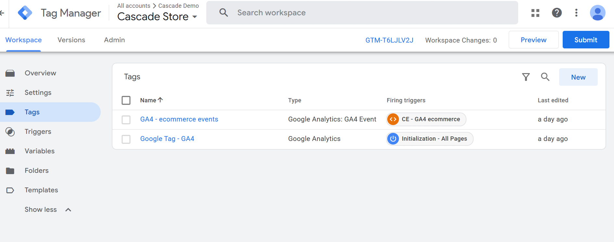
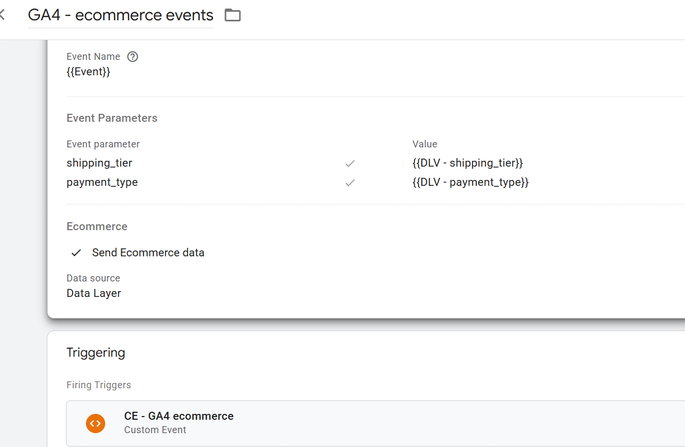
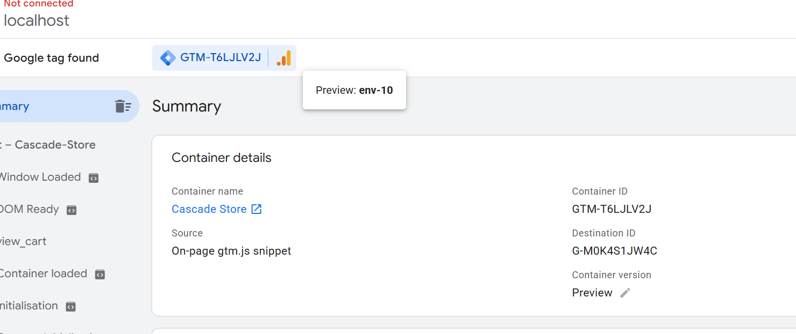
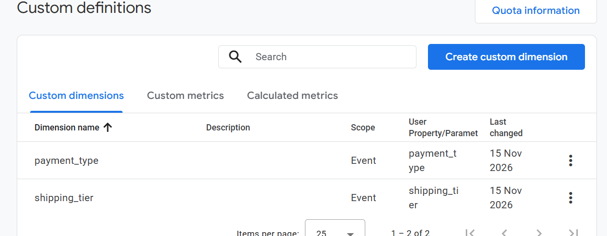
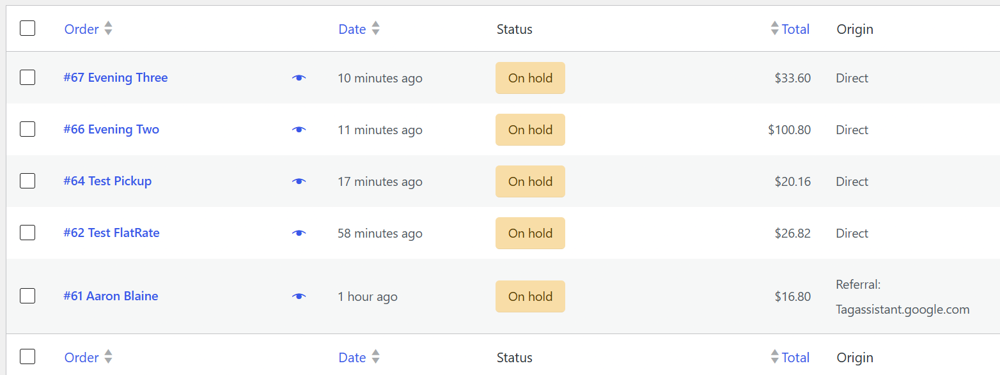
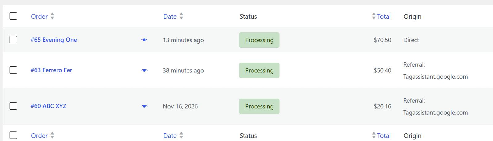

# Screenshots

**1. GTM tags**

Two tags handle everything: one loads GA4 on every page, and one sends all ten ecommerce events.

---

**2. Ecommerce tag**

`{{Event}}` reuses the dataLayer event name, so one tag covers every event. It adds `shipping_tier` and `payment_type` and passes the ecommerce data.

---

**3. Tag Assistant**

The container loads on the store and sends to one GA4 property.

---

**4. GA4 custom dimensions**

Registered before any test orders, so every order can be split by delivery and payment method.

---

**5. On-hold orders**

Bank-transfer and check orders wait for payment, but GA4 counts them as purchases immediately.

---

**6. Test traffic in attribution**

Orders placed during GTM Preview show as *Referral: tagassistant.google.com*. The label also stuck to two later orders, so the reconciliation identifies test orders by GA4's debug flag and the publish time instead.
